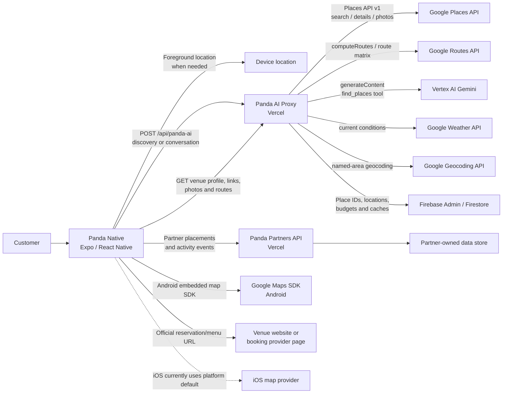

# PANDA

## Native app and Google platform architecture

**Developer architecture guide · Android Build 73 source branch · reviewed 10 November 2026**

Prepared for engineering review and as the source document for a Google technical discussion.

> **Evidence boundary.** This guide describes the Build 73 source branch and the Panda backend code checked for this review. It does not certify Google Cloud project settings, API-key restrictions, billing, quotas, or the exact source commit used to build the supplied APK.

---

## 1. Executive view

Panda is a React Native / Expo mobile application backed by two separate Vercel services:

- **Panda AI Proxy** is the server-side boundary for Google Maps Platform and Vertex AI calls. The mobile app does not call Vertex AI directly and does not contain the server credentials.
- **Panda Partners API** supplies separate partner-facing data, including placement records and venue activity events. It is not the Google Maps Platform layer.
- **Google services** provide place discovery and venue details, photo references and media, route calculations, weather, and the Vertex AI Gemini model used for conversational assistance.
- **Firebase / Firestore**, accessed server-side, supports the Place ID identity index and backend budgets/caches. The separate Panda Partners API owns partner data outside the Google Maps Platform call path.

The Android Build 73 app uses the Google Maps provider in its embedded map. Panda’s planned iOS app is also intended to use Google Maps, but the Build 73 source does **not** select the Google provider on iOS: it leaves iOS to the platform default and has no iOS Google Maps key configuration. That future iOS requirement remains a code and configuration task, not a shipped capability.

Panda reports it is currently working with OpenTable on the reservation partner/API path. In the reviewed Build 73 source, reservation actions still open official venue booking pages; the source does not establish a direct OpenTable API transaction or a confirmed reservation through Google Places.

---

## 2. Source of truth and verification

| Layer | Source checked | Result |
|---|---|---|
| Native app | `panda-native-app`, branch `panda-build-73-venue-exposure`, commit `e1375e52321056eefbe2df39efb71c66340a6c12` | `app.json` sets Android `versionCode` to **73**. |
| Panda AI backend | `panda-ai-proxy`, `main`, commit `fc868f4006aa3322d7bb9c90b327a72838852536` | Current `main` commit matches the latest Vercel production deployment checked for this review; deployment state was `READY`. |
| Panda Partners backend | `panda-partners-api`, `main`, commit `c42a888281df0d9a62c3244e7e1c17cc988fef1e` | Current `main` commit matches the latest Vercel production deployment checked for this review; deployment state was `READY`. |
| Supplied Android APK | `Panda-Android-Build-73-Venue-Analytics…apk` | Its embedded version-control metadata reports `NO_SUPPORTED_VCS_FOUND`; the APK cannot be tied conclusively to a Git commit from that metadata. The Build 73 branch version code matches the stated build number, but that alone does not prove the APK was built from that exact commit. |
| Google Cloud configuration | Not available through the connected GitHub or Vercel checks | API enablement, key restrictions, quotas, billing, project/IAM configuration, and Google-side data policies were not verified. |

**Document convention:** “Implemented” means supported by the checked source code. “Configured” is used only for configuration status that was actually visible. “Not verified” means the code or deployment metadata was not sufficient evidence.

---

## 3. System architecture

**Important distinction:** a server-side call to Places or Routes is not the same as the mobile map SDK. Panda has separate server-side web-service credentials and an Android Maps SDK build-time key.

---

## 4. Main components

### 4.1 Panda Native

- Expo SDK 54, React Native 0.81.5, Expo Router 6, `react-native-maps` 1.20.1, and `expo-location` 19.0.8 in the Build 73 branch.
- Requests current device coordinates for nearby discovery and directions. The area label is derived with Expo Location reverse geocoding asynchronously; a failed area lookup does not block coordinate-based discovery.
- Uses `https://panda-ai-proxy.vercel.app` as its runtime and discovery API base.
- Uses `https://panda-partners-api.vercel.app` separately for partner placement/activity data.
- Shows Google-backed venue results, Panda-owned UI, photos, route geometry, and optional external handoffs.

### 4.2 Panda AI Proxy

- Vercel serverless API at `panda-ai-proxy.vercel.app`.
- Keeps Google web-service credentials and the Vertex AI service identity server-side.
- Routes discovery, profile, photo, directions, weather, and AI requests to the appropriate provider.
- Applies request guards and service-side usage/budget controls in code. The actual production thresholds and Google Cloud quota configuration were not inspected.

### 4.3 Panda Partners API

- Separate Vercel API at `panda-partners-api.vercel.app`.
- Supplies partner-related data and activity endpoints; it is not an intermediary for Places, Routes, or Vertex AI.
- The Build 73 client reads `/api/public/sponsored-venues` and maps returned tiers to promoted venue UI. This is current code behavior; it should be checked against Panda’s current commercial rule before making a public “no paid ranking” claim.

---

## 5. End-to-end flows

### A. Nearby discovery

1. The app obtains the user’s current location through Expo Location. If location permission or location data is unavailable, it does not pretend that an unverified result is nearby.
2. The Build 73 discovery client sends a `POST` to `/api/panda-ai` with `venuesOnly: true`, `discoveryMode: "cover"`, a query or category, and latitude/longitude. Pagination or an expansion radius can be included.
3. The proxy calls Places API (New) `places:searchText` or `places:searchNearby`, with a field mask. The lightweight result includes the Place ID, display name, formatted address, coordinates, type information, a photo reference, and photo attribution.
4. The proxy normalizes and distance-filters results and returns venue cards. This `venuesOnly` path does **not** require a Gemini response.
5. The Build 73 client keeps category-feed results in an in-memory cache for up to 30 minutes. Network and quota failures have explicit error states.

**Build 73 mode note:** the home screen’s helper named `fetchIndexedFeedPage` sends `discoveryMode: "cover"` in its request body. Do not infer that the Build 73 app calls the newer backend `indexed-feed` mode from the helper’s name. The proxy currently contains both code paths, but the checked Build 73 client sends the `cover` mode.

### B. Conversational Panda AI

1. The app sends conversation contents, the device time zone, generation settings, and location only when the task needs local results to `POST /api/panda-ai`.
2. The proxy uses Google authentication from its server-side service-account configuration to call Vertex AI’s Gemini `generateContent` endpoint. The model can request the declared `find_places` tool when a venue search is appropriate.
3. The proxy performs any required Places search and returns the assistant text plus grounded venue results to the app.
4. When the model/service is unavailable or a budget guard is reached, the backend has a degraded response path for supported venue searches. This is a fallback, not a guarantee that every AI request will complete.

The mobile app does not call Vertex AI directly.

### C. Venue profile, photos, menus, and reservations

1. Opening a venue can request `/api/partner/venues/{placeId}/profile`. The proxy calls Places Details with a field mask for venue identity, address, location, rating/count, price level, current hours, phone, website, photos, and selected amenity/service attributes.
2. The app requests `/api/partner/venues/{placeId}/photos`. The proxy obtains Places photo names and author attributions, then serves image bytes from `/api/partner/venues/{placeId}/photos/{photoIndex}/image`.
3. The mobile client loads those Panda proxy URLs; the Google server key is not sent to the phone in the image URL.
4. For menus and reservations, the code resolves an official venue website and links to its menu or booking page when available. The app presents that page in an in-app browser/WebView or offers the original page in the browser.

**Booking boundary:** the reviewed Build 73 flow records a booking-page click and opens the venue’s official page. It does not, by itself, prove a live OpenTable API booking, a confirmed reservation, or a booking API partnership. A link to an OpenTable page is still a link, not an API reservation transaction.

### D. Routes and maps

1. The app requests a venue transit or walking route from the Panda AI Proxy, passing the Place ID and origin coordinates.
2. The backend can use Places Nearby Search to find a nearby transit station and Google Routes `computeRoutes` to calculate walking or transit journeys. Route responses include duration/distance, step data, and encoded polylines; the route endpoint can use transit departure information when available.
3. Panda decodes and draws route segments and venue/station markers in its embedded map. The user can also hand off to Google Maps for navigation.
4. The route service may enrich UK transit timings with TfL live-departure data; the source distinguishes live timing from a Google route estimate.

### E. Weather

Weather questions are handled server-side through Google Weather API `currentConditions:lookup`. The mobile app does not call the Weather API directly.

---

## 6. API and provider map

| Panda endpoint or mobile component | Use | External provider |
|---|---|---|
| `POST /api/panda-ai` with `venuesOnly: true`, `discoveryMode: "cover"` | Nearby/category discovery; pagination | Places API (New): `places:searchText` or `places:searchNearby` |
| `POST /api/panda-ai` with conversation `contents` | Conversational response; optional venue search | Vertex AI Gemini `generateContent`; `find_places` tool; Places API (New) |
| `GET /api/partner/venues?query=…` | Resolve a venue from a follow-up request | Panda proxy; Google Place IDs and venue profile logic |
| `GET /api/partner/venues/{placeId}/profile` | Current venue details and features | Places API (New) Place Details |
| `GET /api/partner/venues/{placeId}/photos` | Photo references and attribution | Places API (New) Place Details photo fields |
| `GET /api/partner/venues/{placeId}/photos/{photoIndex}/image` | Proxied photo bytes | Places API (New) photo media |
| `GET /api/partner/venues/{placeId}/transit` | Transit option, route steps, timing | Routes API `computeRoutes`; Places Nearby Search; optional TfL live timing |
| `GET /api/partner/venues/{placeId}/walking` | Walking route and polyline | Routes API `computeRoutes` |
| Backend route-matrix helper | Bounded travel-time checks for selected candidate groups | Routes API `distanceMatrix/v2:computeRouteMatrix` |
| `GET /api/partner/transit/nearest` | Nearest transit candidates | Places API (New) Nearby Search |
| Native Android embedded map | Map, markers, polylines | Google Maps SDK for Android via `react-native-maps` |
| Server-side current weather lookup | Weather answers | Google Weather API `currentConditions:lookup` |
| Named-area lookup in AI service | Resolve text area to coordinates | Google Geocoding API |

The API paths above are from the checked source. They are not a promise that every endpoint has been exercised in a live end-to-end user session.

---

## 7. Data Panda saves and how it is served

The app and backend use several different stores. The table below separates **Panda application storage** from the data requested from Google. A cache freshness rule controls whether Panda serves a record; it does not necessarily delete the record from Firestore.

| Data | Where Panda stores or processes it | Source-backed behavior and retention | What remains unverified |
|---|---|---|---|
| Build 73 cover-discovery response | Returned through the Vercel proxy; category results are held in an app-process memory cache | The proxy hard-codes `persistFullContent: false` on `discoveryMode: "cover"`. The native category cache is in memory for up to 30 minutes. | Production request logs and any platform-level caching outside this code review. |
| Place ID identity index | Firebase Admin / Firestore collections `panda_london_place_ids_v1` and `panda_london_place_locations_v1` | Stores Place IDs, venue coordinates, search context/last-indexed metadata, and Panda-owned photo paths. The index code does not store venue names, Google photo names, or opening hours. Panda’s rollout note specifies a 29-day coordinate-expiry target. | Firestore TTL configuration and physical deletion timing. The index is London-seeded, not a complete London census or global venue catalogue; live search is not restricted to the sampled IDs. |
| Rich AI / Planner Places search | Firestore collection `places_cache_v2` in the Panda AI Proxy | The source writes a venue result array, page token, timestamp, and a truncated search query. Results are treated as fresh for 30 minutes; stale results may be used for up to 24 hours during quota/provider failure. The cache key is derived from query and rounded location. | Physical deletion/TTL for expired documents and Google permission for cross-user reuse of each stored field. |
| Other rich venue listings | Firestore collection `venue_search_cache_v1` through the proxy’s venue-live helper | Search-result arrays have a default 30-minute read-freshness window. | Physical deletion/TTL and whether every caller is active in the Build 73 user journey. |
| Photos | Google photo metadata is fetched by the proxy; image bytes are streamed through Panda’s image endpoint. The mobile app keeps photo lists in memory. | The app’s photo-list cache is in memory for up to three hours; Google author attribution is retained and displayed. The proxy source defines shared-photo cache helpers (6-hour memory, 24-hour shared, 7-day stale), but the reviewed `getVenuePhotos` path calls the live loader directly and does not invoke those helpers. | Physical image retention, production logging, and any other cache layer outside the reviewed path. Do not describe the helper cache as active without further verification. |
| Saved venues | Device `AsyncStorage`, key `@panda-mobile/saved-venue-ids` | The saved-venue store persists Place IDs; current venue facts/photos are hydrated through Panda’s API when needed. | Account sync or device backup behavior outside this source file. |
| Venue engagement events | Device `AsyncStorage` outbox, key `panda_venue_activity_pending_v1`, then the separate Panda Partners API at `/api/track` | The client event schema contains event type, Place ID, venue name, timestamp, platform, surface, and placement. Pending events remain queued until the server confirms receipt. These are Panda events, not Google Places requests. | Partner backend storage, event retention, user/account linkage, and access controls were not audited here. |
| AI conversation and operational counters | Conversation contents are sent from the app through Vercel to Vertex AI. Firestore can store daily usage counters when limits are configured; Vercel logs may record cost events. | No persistent conversation-history write was found in the reviewed `api/panda-ai.js` handler. A shared five-minute Gemini function-call cache is opt-in; `PANDA_SHARED_GEMINI_CACHE` was not present in the production environment-variable name list and the code defaults it off. Cost-event logs are emitted only when `PANDA_USAGE_METRICS` is true; its deployed value was not read. | Vercel access/runtime log retention, Vertex AI processing/retention terms, the deployed metrics setting, and any data written by other services. |

### Location and model routing

- Coordinates are sent to Panda’s backend for nearby discovery and route requests. The transit endpoint receives coordinates in query parameters; Vercel access-log retention was not inspected.
- The Build 73 home screen uses Expo Location reverse geocoding for an optional area label. It runs asynchronously and does not delay coordinate-based discovery.
- The proxy code sends Gemini 3-family models to the Vertex AI global endpoint and uses `PANDA_LOCATION` for other supported model paths. The deployed `PANDA_MODEL` value was not read, so this document does not assert the exact production model or processing region.
- The source review did not inspect production logs, analytics records, user-facing privacy notices, or account-linked retention controls. This is not a complete privacy assessment.

### Google data and attribution

- The lightweight discovery field mask asks for Place ID, display name, formatted address, location, primary/additional types, photo name/attribution, and the page token where applicable.
- Panda requests Places photo metadata and preserves the returned `authorAttributions`.
- Rich venue details are fetched on demand through the proxy. Different backend paths have different cache behavior; do not describe all Google content as “not stored.”
- Google Maps Platform storage and reuse permission should be confirmed for each field and cache above. The proxy rollout note itself says the dormant full-content cache must not be enabled without written approval and a reviewed retention configuration.

---

## 8. Credentials and security boundary

### What the source and deployment metadata show

Vercel’s production environment-variable listing showed the following names for `panda-ai-proxy`, marked as sensitive where applicable. **No values were read or included here.**

- `GOOGLE_MAPS_API_KEY` — server-side Google Maps Platform web-service key.
- `GOOGLE_SERVICE_ACCOUNT` — server-side Google authentication for Vertex AI.
- `FIREBASE_SERVICE_ACCOUNT` — server-side Firebase Admin / Firestore access.
- `PANDA_MODEL`, `ALLOWED_ORIGIN` — configuration names; their values were not read.

The Build 73 Android app configuration reads `GOOGLE_MAPS_ANDROID_KEY` at EAS build time and fails an Android EAS build if the key is absent. Its value and Android package/signing restrictions were not inspected.

### Recommended verification before broader release

1. Confirm the server key is API-restricted to the exact Google APIs used by this backend. The code uses the server key with Places, Routes, Weather, and Geocoding calls; confirm the final allow-list against enabled routes in production.
2. Keep the Android Maps SDK key separate from the web-service key and restrict it to the Android app package and signing certificate(s).
3. Before an iOS build, configure a distinct iOS Maps SDK key with the appropriate bundle-ID restrictions, and explicitly select Google Maps as the provider in the native map component.
4. Review Vercel origin controls, endpoint guards, daily budgets, Cloud quotas, billing alerts, and monitoring together. Source and Vercel variable names alone do not prove the production policy is correctly restricted.
5. Keep service-account JSON and API key values in secret managers only. No credential values belong in the app bundle, public GitHub repository, or a Google-facing document.

---

## 9. Known gaps and claims to avoid

- **iOS map provider:** Panda intends to use Google Maps in its future iOS app. Build 73 selects `PROVIDER_GOOGLE` only on Android; on iOS the provider is `undefined`, and no iOS Google Maps key setup was found. The future iOS behavior is not yet implemented.
- **Google Cloud policy/configuration:** the API enablement, billing account, quotas, key restrictions, Vertex IAM role, and Maps Platform data-policy approvals were not visible through the repository or the Vercel metadata available for this review.
- **Venue coverage:** Google Places responses depend on Google’s country/region coverage, data quality, user location, field availability, quotas, and service terms. The London-seeded identity index is not a global venue catalogue, and the code does not establish complete coverage for every venue or country.
- **Reservations:** Panda reports it is currently working with OpenTable on the partner/API path. The checked Build 73 source still uses official venue booking links; it does not establish direct OpenTable API transactions or confirmed bookings.
- **Paid placement rule:** Build 73 currently reads partner placement records and marks them as promoted. That behavior should be reconciled with any current commercial policy that says subscriptions do not buy ranking.
- **APK provenance:** the version code matches the Build 73 branch, but the supplied APK does not contain a source-control commit identifier. The exact APK-to-branch match remains unverified.
- **Existing documentation:** some older native handover pages reference `artifacts/panda-mobile` and `artifacts/api-server`. Those paths do not describe the root-level native repository and external Vercel APIs now checked. This guide should supersede those path assumptions.

---

## 10. Questions for Google technical review

1. Are the current Places field masks and the division between lightweight discovery and on-open Place Details an appropriate pattern for Panda’s use case?
2. Which Places fields, photo references, attribution, Place IDs, coordinates, and search-result data may Panda cache locally or server-side, and for how long?
3. Do the cache paths and stale-on-quota behavior described above comply with applicable Maps Platform terms? What physical deletion/TTL controls should Panda implement?
4. Is proxying Places photo media through Panda’s server an acceptable implementation, and what attribution, refresh, and image-delivery requirements should Panda preserve?
5. What Maps SDK for iOS configuration and key restrictions should Panda use for the planned iOS build in Expo/React Native?
6. Which API restrictions, separate keys, quotas, billing alerts, and monitoring controls do you recommend for Vercel serverless calls to Places, Routes, Weather, and Geocoding?
7. Given the Vertex AI model/region routing in source, which project, IAM, location, monitoring, and data-handling controls should Panda validate?
8. What coverage, feature, language, and quota differences should Panda plan for when expanding discovery beyond the UK?

---

## 11. Source references

### Panda Native — Build 73 branch

- [Build 73 branch and source tree](https://github.com/duncann38-sys/panda-native-app/tree/panda-build-73-venue-exposure)
- [`app.json` — Android version code](https://github.com/duncann38-sys/panda-native-app/blob/panda-build-73-venue-exposure/app.json)
- [`app.config.js` — Android Maps key injection](https://github.com/duncann38-sys/panda-native-app/blob/panda-build-73-venue-exposure/app.config.js)
- [`constants/services.ts` — Panda runtime service URLs](https://github.com/duncann38-sys/panda-native-app/blob/panda-build-73-venue-exposure/constants/services.ts)
- [`components/NativeGoogleMap.native.tsx` — native map provider and route rendering](https://github.com/duncann38-sys/panda-native-app/blob/panda-build-73-venue-exposure/components/NativeGoogleMap.native.tsx)
- [`app/(tabs)/index.tsx` — Build 73 discovery requests](https://github.com/duncann38-sys/panda-native-app/blob/panda-build-73-venue-exposure/app/%28tabs%29/index.tsx)
- [`app/ai.tsx` — Panda AI, venue, and transit requests](https://github.com/duncann38-sys/panda-native-app/blob/panda-build-73-venue-exposure/app/ai.tsx)
- [`components/VenuePhoto.tsx` — photo proxy use and client cache](https://github.com/duncann38-sys/panda-native-app/blob/panda-build-73-venue-exposure/components/VenuePhoto.tsx)
- [`components/VenueBrowserScreen.tsx` — official menu and booking pages](https://github.com/duncann38-sys/panda-native-app/blob/panda-build-73-venue-exposure/components/VenueBrowserScreen.tsx)
- [`context/saved-venues.tsx` — locally persisted Place IDs](https://github.com/duncann38-sys/panda-native-app/blob/panda-build-73-venue-exposure/context/saved-venues.tsx)
- [`utils/venue-activity.ts` — venue activity event schema and outbox](https://github.com/duncann38-sys/panda-native-app/blob/panda-build-73-venue-exposure/utils/venue-activity.ts)

### Panda AI Proxy — current main branch

- [Panda AI Proxy repository](https://github.com/duncann38-sys/panda-ai-proxy/tree/main)
- [`DISCOVERY_INDEX.md` — rollout, cache, and region-scope notes](https://github.com/duncann38-sys/panda-ai-proxy/blob/main/DISCOVERY_INDEX.md)
- [`api/panda-ai.js` — discovery, Vertex AI, and Places orchestration](https://github.com/duncann38-sys/panda-ai-proxy/blob/main/api/panda-ai.js)
- [`api/_discovery-lite.js` — cover discovery and field mask](https://github.com/duncann38-sys/panda-ai-proxy/blob/main/api/_discovery-lite.js)
- [`api/_venue-live.js` — Place Details and Routes calls](https://github.com/duncann38-sys/panda-ai-proxy/blob/main/api/_venue-live.js)
- [`api/_venue-photos.js` — Google photo metadata and media proxy](https://github.com/duncann38-sys/panda-ai-proxy/blob/main/api/_venue-photos.js)
- [`api/_current-weather.js` — Google Weather API](https://github.com/duncann38-sys/panda-ai-proxy/blob/main/api/_current-weather.js)
- [`api/_official-venue-links.js` — official menu/reservation link extraction](https://github.com/duncann38-sys/panda-ai-proxy/blob/main/api/_official-venue-links.js)
- [`api/_london-index.js` — Place ID identity index](https://github.com/duncann38-sys/panda-ai-proxy/blob/main/api/_london-index.js)
- [`api/_cost-controls.js` — cache and usage-budget helpers](https://github.com/duncann38-sys/panda-ai-proxy/blob/main/api/_cost-controls.js)

### Panda Partners API

- [Panda Partners API repository](https://github.com/duncann38-sys/panda-partners-api/tree/main)
- [Panda AI Proxy production domain](https://panda-ai-proxy.vercel.app)
- [Panda Partners API production domain](https://panda-partners-api.vercel.app)

### Google policy references already cited by Panda’s proxy rollout note

Confirm the current terms and their applicability with Google; the presence of these references in Panda’s repository is not itself policy approval.

- [Google Places API policies](https://developers.google.com/maps/documentation/places/web-service/policies)
- [Google Maps Platform service terms](https://cloud.google.com/maps-platform/terms/maps-service-terms)

---

**Handling note:** this document contains public repository paths, public API domains, and credential *names* only. It contains no API-key values, service-account JSON, or private tokens.
